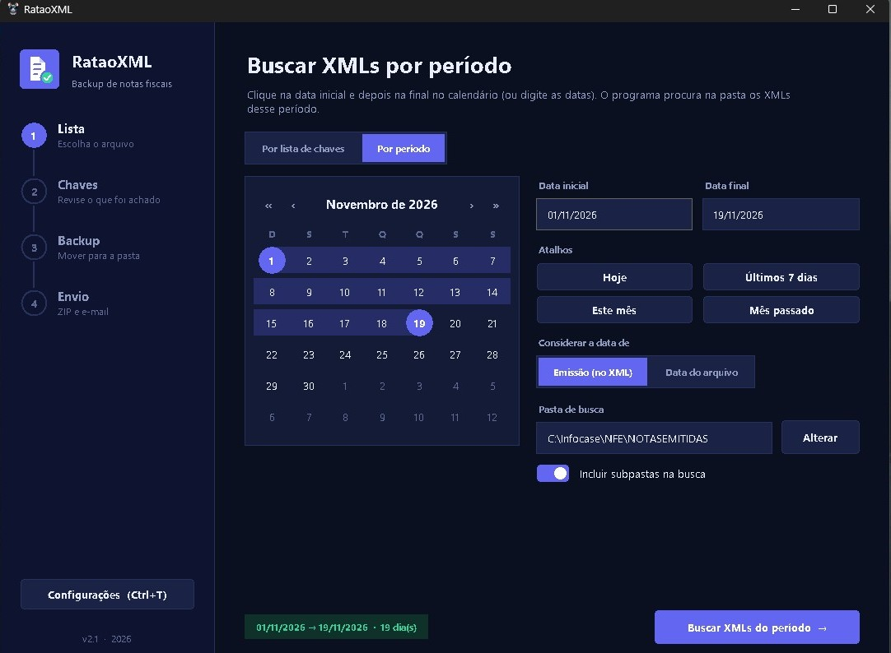

# RataoXML

<p align="center">
  
</p>

<p align="center">
  <strong>Organize, compacte e envie XMLs de notas fiscais sem depender de planilhas complicadas.</strong>
</p>

<p align="center">
  
  
  
</p>

## 📌 Sobre o projeto

O **RataoXML** é um aplicativo desktop local para localizar arquivos de notas fiscais pela chave de acesso de 44 dígitos. Ele foi criado para reduzir o trabalho manual de organizar XMLs, cópias de segurança e envios por e-mail.

Toda a configuração sensível é informada pelo usuário ou por variáveis de ambiente. Nenhuma API key, senha ou endereço de e-mail pessoal é distribuído neste repositório.

## ✨ Funcionalidades

- Interface gráfica moderna em modo escuro.
- Interface de linha de comando para automações e uso em lote.
- Busca pela chave de acesso de 44 dígitos no nome dos arquivos.
- Busca recursiva em subpastas.
- Busca por período de emissão ou data de modificação.
- Movimento ou cópia dos arquivos encontrados.
- Proteção contra sobrescrita quando o arquivo já existe no destino.
- Geração de arquivo ZIP.
- Opção de incluir somente XMLs ou todos os arquivos.
- Envio por **Resend**, **Gmail** ou **Outlook**.
- Suporte a vários destinatários.
- Armazenamento das configurações em `config.json`, localizado ao lado do executável.

## 🖥️ Modo gráfico

Execute:

```bat
python procurar.py
```

O modo gráfico permite selecionar os arquivos, pasta de origem e destino, gerar o ZIP e configurar o envio por e-mail.

## 🖼️ Demonstração

Tela de busca por período, permitindo escolher datas, tipo de data, pasta de origem e opções de processamento:

<p align="center">
  
</p>

## ⌨️ Modo console

Busca com uma lista de chaves:

```bat
python procurar.py lista.txt -r
```

Copia em vez de mover:

```bat
python procurar.py lista.txt -d BKP_ABC --copiar
```

Gera um ZIP:

```bat
python procurar.py lista.txt --zip
```

Envia por e-mail:

```bat
python procurar.py lista.txt --email alguem@example.com
```

Busca por período:

```bat
python procurar.py --de 01/10/2026 --ate 31/10/2026 -r
```

Consulte todas as opções:

```bat
python procurar.py --help
```

## 🔐 Configuração de e-mail

Na interface gráfica, abra as configurações pelo atalho `Ctrl+T`.

As credenciais podem ser configuradas no arquivo `config.json`, criado ao lado do executável, ou pelas seguintes variáveis de ambiente:

```bat
set RESEND_API_KEY=sua_api_key
set RESEND_FROM_EMAIL=seu-remetente@example.com
set SMTP_USER=seu-email@example.com
set SMTP_PASSWORD=sua-senha-de-app
set EMAIL_DESTINO=destinatario@example.com
set EMAIL_PROVIDER=resend
```

Também é possível usar Gmail ou Outlook com uma **senha de aplicativo**. Nunca use sua senha normal da conta nem publique suas credenciais no repositório.

O arquivo de configuração local é ignorado pelo Git por padrão.

## 🧰 Instalação para desenvolvimento

Crie e ative um ambiente virtual:

```bat
python -m venv .venv
.venv\Scripts\activate
```

Instale as dependências de desenvolvimento:

```bat
pip install -r requirements.txt
```

Execute o aplicativo:

```bat
python procurar.py
```

Execute os testes:

```bat
python -m pytest -q
```

## 📦 Gerar o executável

O projeto usa PyInstaller:

```bat
python -m PyInstaller --noconfirm --clean RataoXML.spec
```

O executável será gerado em `dist/RataoXML.exe`.

## 🔒 Privacidade e segurança

- O repositório não inclui `config.json`.
- O repositório não inclui API keys, senhas ou dados pessoais.
- Arquivos XML, listas de chaves, ZIPs e backups são mantidos fora do repositório por padrão.
- Verifique o arquivo `.gitignore` antes de realizar o primeiro commit.

## 📁 Estrutura principal

```text
procurar.py       Aplicativo, núcleo de processamento e interface gráfica
RataoXML.spec     Configuração de empacotamento PyInstaller
RataoXML.ico      Ícone do aplicativo
logo.png          Identidade visual usada neste README
tests/            Testes automatizados
```

## 🧪 Testes

Os testes cobrem:

- Extração de chaves sem duplicatas.
- Criação de arquivos ZIP.
- Inclusão dos arquivos XML no ZIP.

## ⚠️ Observações

- O envio via Resend exige uma API key válida e pode estar limitado pelo status de verificação do remetente/domínio.
- Gmail e Outlook exigem autenticação por senha de aplicativo.
- Consulte e respeite as políticas de privacidade da sua empresa antes de processar documentos fiscais.
